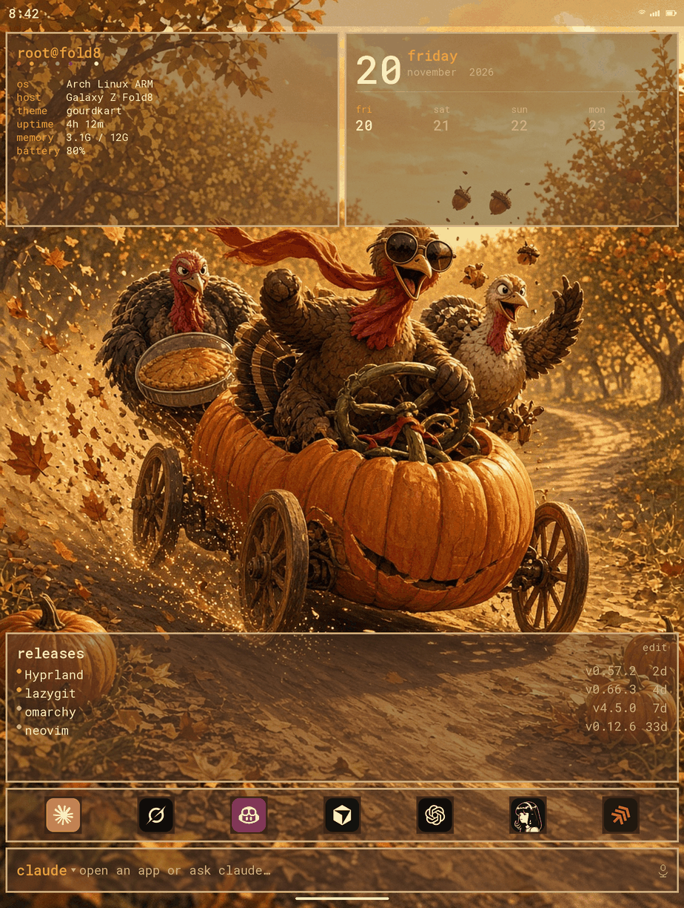

# gourdkart

a turkey in sunglasses tearing down an orchard lane in a pumpkin go-kart: cinnamon brown, cream type, harvest-gold accent

dreamed up by jack.



## Palette

| Key | Value |
|-----|-------|
| `mode` | `dark` |
| `accent` | `#f0a03a` |
| `selection` | `#6e4c34` |
| `muted` | `#d0ae80` |
| `background` | `#5a3c28` |
| `dark_background` | `#4a3020` |
| `darker_background` | `#3a2418` |
| `lighter_background` | `#6c4c34` |
| `foreground` | `#f4e6c8` |
| `dark_foreground` | `#d0ae80` |
| `light_foreground` | `#f8eed8` |
| `bright_foreground` | `#faeeda` |

Full `colors.toml`:

```toml
mode = "dark"

accent = "#f0a03a"
selection = "#6e4c34"
muted = "#d0ae80"

background = "#5a3c28"
dark_background = "#4a3020"
darker_background = "#3a2418"
lighter_background = "#6c4c34"

foreground = "#f4e6c8"
dark_foreground = "#d0ae80"
light_foreground = "#f8eed8"
bright_foreground = "#faeeda"

red = "#d45c48"
yellow = "#f0a03a"
orange = "#e07830"
green = "#7a8a50"
cyan = "#7a8a78"
blue = "#5a6a7a"
magenta = "#b06060"
brown = "#8a5a38"

bright_red = "#e87864"
bright_yellow = "#f8c068"
bright_green = "#98a868"
bright_cyan = "#98a894"
bright_blue = "#7a8a9a"
bright_magenta = "#c87878"
```

## Install

Paste this URL into Omalauncher's theme install:

https://github.com/TheFifeDawg/omarchy-gourdkart-theme

On an Omarchy laptop: **Install > Style > Theme**, paste the same URL.

## Wallpapers

The three wallpapers are AI-generated original art:

- `1-gourdkart.jpg` — a sunglasses turkey driving a pumpkin go-kart down an orchard lane, with two passengers along for the ride
- `2-hayjump.jpg` — the same crew mid-air over a hay-bale ramp, while a scarecrow judge holds up score paddles
- `3-piestand.jpg` — the kart parked at a roadside pie stand at dusk, turkeys in fake mustaches buying pie from a baker-turkey

They're sized 1848×2448 for the Samsung Galaxy Z Fold 8 inner screen and framed to center-crop cleanly to the cover screen (1248×1972).

## Extras

Includes a `btop.theme` built from Omarchy's template, so the palette carries over to btop on a laptop.

## License

MIT. See [LICENSE](LICENSE).
